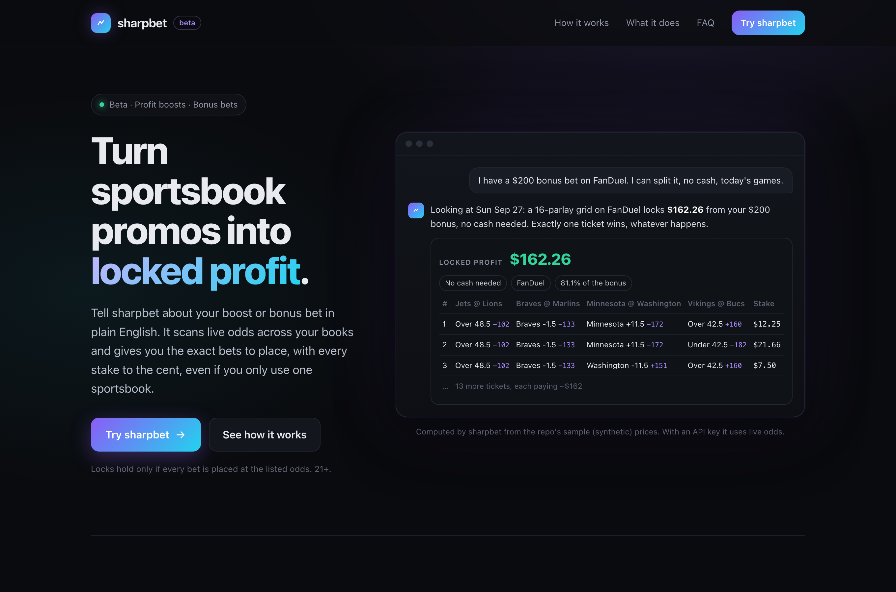

# sharpbet

**A conversational assistant that turns sportsbook promos into exact, locked bet slips.**

Describe a promo in plain English, like *"I have a $200 bonus bet on FanDuel"* or *"two 50% boosts, $300 max
each, or one 100% boost?"*, and sharpbet answers with the exact bets to place: which book, which legs, the odds,
and the stake to the cent, so that every possible outcome pays the same amount.



## Why it's interesting

- **The LLM never does math.** Claude parses the conversation and calls tools; every number comes from tested
  Python. An *untraced-number guard* flags any dollar amount, odds or percentage in a reply that no tool
  produced, and slips are rendered from structured data, never re-typed by the model.
- **Single-book bonus conversion.** A bonus bet (stake not returned) is split across every combination of
  parlay outcomes at *one* sportsbook (e.g. 16 four-leg parlays), sized so exactly one ticket wins and every
  outcome pays the same. On the sample prices, a $200 FanDuel bonus locks **$162.26 (81.1%)** with no cash and no
  second account. The optimizer searches 2- to 5-leg grids, mixing 2-way and 3-way legs, and re-solves if prices
  move partway through placing.
- **Several profit boosts at once.** Assigns each boost to a game and side, lets boosts hedge *each other* (a
  boosted Over vs. a boosted Under), tops up with cash at the best price across books, and respects per-boost
  rules (sport, time slot like "Sunday Night Football", minimum odds) and a shared cash limit.
- **"Which offer is worth more?"** Plans each option with the same solvers on the same prices and reports the
  winner, the margin, and whether the answer flips with more cash.
- **Arbitrage research.** A linear program over *every possible final outcome* of a game (all 1,470 best-of-3
  tennis score lines, every final margin, every total) across 8 sportsbooks plus the Kalshi and Polymarket
  exchanges, each with its own settlement rules. See [research/](research/README.md).

## Demo (no API keys needed)

```bash
pip install -e '.[dev,web]'
SHARPBET_DEMO=1 PORT=8001 python web/server.py      # then open http://127.0.0.1:8001
```

Demo mode uses the sample prices in `tests/fixtures/` and a scripted assistant, so it costs nothing. Try
"$200 bonus bet on fanduel", "50% boost on draftkings", "boosts", or "two 50% boosts or one 100% boost?".

## With live odds and Claude

Live mode needs two API keys of your own, and both services are usage-based:

| Service | What it's used for | Cost |
|---|---|---|
| [The Odds API](https://the-odds-api.com) (`ODDS_API_KEY`) | Live prices from the sportsbooks | Free tier: 500 credits/month. A typical question pulls 4 sports for about 12 credits (3 per sport); paid plans for regular use |
| [Anthropic API](https://console.anthropic.com) (`ANTHROPIC_API_KEY`) | Claude, which runs the conversation | Pay as you go (prepaid credits). The app shows the cost of every reply |

Copy `.env.example` to `.env`, add both keys, then run `python web/server.py` (or `python chat.py` in the
terminal). Each conversation stops at a **$1.00 spend cap** by default (`SHARPBET_MAX_SPEND` for the web app,
`--max-spend` for the terminal), odds are cached for 5 minutes per conversation, and `--dry-run` shows the
odds-API credit cost before anything is pulled. **Demo mode needs neither key.**

```bash
python scripts/live.py --book fanduel --bonus 200 --dry-run     # show the odds-API credit cost only
python scripts/live.py --book fanduel --bonus 200               # real slips from live prices
```

## Tests

```bash
python -m pytest -q        # 129 tests
```

Core math is pinned to hand-checked numbers (a 4×(-110) grid converts 76.77%; a 50% boost on a -110/-110 total
with $250 locks $31.38). The adapter, chat and web tests run on **synthetic** sample prices that keep the exact
shape of real API responses ([tests/fixtures/synthesize.py](tests/fixtures/synthesize.py)). No third-party odds
data is included in this repo.

## Layout

```
sharpbet/            math core: odds, grids, hedges, boosts, multi-boost, comparisons, rule checks
sharpbet/data/       The Odds API adapter (query-driven pulls, credit estimates)
sharpbet/assistant/  Claude tool layer: tools, system prompt, chat session with guard and spend cap
web/                 FastAPI app: streaming chat, stop, structured slips, landing page, demo mode
research/            arbitrage optimizers across sportsbooks, Kalshi and Polymarket
scripts/             command-line runs on live or made-up prices
```

Design decisions and lessons learned: [DESIGN.md](DESIGN.md).

## Responsible use

For adults 21+ where sports betting is legal. sharpbet only tells you what to place; it never places bets or
automates a sportsbook. A lock holds only if every bet is placed at the listed odds, and sportsbooks' promo terms
may restrict hedging or betting both sides. Gambling problem? Call **1-800-GAMBLER**.

## License

MIT © 2026 Karthik Iyer
